 

### 👋 Welcome to the home of **Clank**

*One platform to plan, run and track your security tests, from a single scan to a full audit.*

 

<table>
  <tr>
    <td align="center" width="25%">
      <h1>🧩</h1>
      <b>Custom workflows</b> 
      Chain your favourite tools in any order
    </td>
    <td align="center" width="25%">
      <h1>🚀</h1>
      <b>Built to scale</b> 
      Spread tests across many machines
    </td>
    <td align="center" width="25%">
      <h1>🗂️</h1>
      <b>All in one place</b> 
      Assets and findings, neatly organised
    </td>
    <td align="center" width="25%">
      <h1>🤝</h1>
      <b>Team ready</b> 
      Fits the way your team already works
    </td>
  </tr>
</table>

 

## ⚡ How it works

## 🎯 Built for

| 🏢 Companies | 🛡️ Security teams | 🐞 Bug bounty hunters |
|:---:|:---:|:---:|
| Continuous audits of your attack surface | Shared workflows and results | Faster recon, more findings |

 

> ⚠️ **Clank is meant for authorised security testing only.** 
> Always get permission before testing systems you do not own.

 

**💬 Ideas, feedback and contributions are always welcome!**

Made with ❤️ by the Clank Security team

